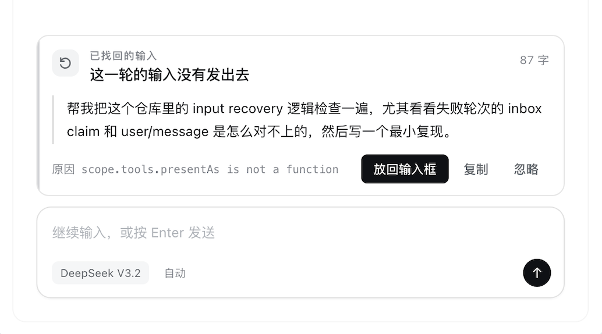

# dsh-pocket-kit

English · [简体中文](README.zh.md)

Pocket Kit (口袋工具箱) — a small collection of independent [DeepSeek Harness](https://github.com/deepseek-ai/deepseek-harness) features, each with its own switch on the plugin's Settings page (all on by default, except the opt-in model-picker override).


## Features

### Pin directory picker to in-app browse — `pinBrowsePicker`

Keeps *Add workspace* on the built-in directory browser instead of the macOS system file panel (which the stock auto selector picks, and which can flip between launches with proxy/bind changes). Changing this switch requires a DSH restart; turning it off restores the system default on the next start.

### Recover swallowed input — `inputRecovery`

When a turn fails (error / interrupted / aborted) after you typed a prompt that was swallowed with it, the text is saved and offered back in the conversation as a restore-to-draft banner.

[](lib/assets/lost-input.png)

### Replace the corner logo — `customLogo`

Swaps the sidebar's top-left whale mark for the whale-girl artwork bundled as `lib/assets/whale-girl.png`. The image ships with the package and is deliberately not configurable — DSH does not require SVG, because the mark is a slot that accepts any element, not a file.

[](lib/assets/whale-girl.png)

### Force the system model picker — `forceSystemModelPicker`

When another plugin occupies the composer's model control (such as the flat
panel from `dsh-model-flatmap`, or `dsh-acp-agents`), this opt-in switch disables
those Loader rows at startup so DSH's own picker takes over. A plugin this
release does not know about can be named through `extraOccupants`. Note that
disabling ACP also turns off ACP delegation. Requires a DSH restart.

Details, HTTP surface and the "how it works" notes live in [docs/DETAIL.md](docs/DETAIL.md).

## Install

Published as [`dsh-pocket-kit`](https://www.npmjs.com/package/dsh-pocket-kit). Add it to your DSH profile:

```jsonc
// ~/.dsh/profiles/<profile>/package.json
{
  "dependencies": {
    "dsh-pocket-kit": "^1.0.1"
  },
  "dsh": { "profile": { "bundles": [ "dsh-pocket-kit", /* ... */ ] } }
}
```

Then run `npm install` in the profile directory and restart DSH.

To work on a local checkout instead, replace the version with
`link:/path/to/dsh-pocket-kit`.

The bundled `cordis.patch.yml` pins the browse picker at boot. Most feature
switches react to volatile config changes without a restart, but
`pinBrowsePicker` is the exception: because the picker is a Host-backend +
Client-surface pair mounted at boot, toggling it only takes effect after you
restart DSH (the Settings row says so too).

## Develop

```sh
npm test   # ten suites: host, config, client, render, banner, pin-switch, logo, logo-client, resolve, force-native-host
```

Add a feature: register it in `lib/features/index.js`, declare its config key in
`lib/index.js` (`z.boolean().default(true).volatile()`), and add its copy keys to
the client's dictionaries. See [docs/DETAIL.md](docs/DETAIL.md#adding-a-feature).

## License

MIT