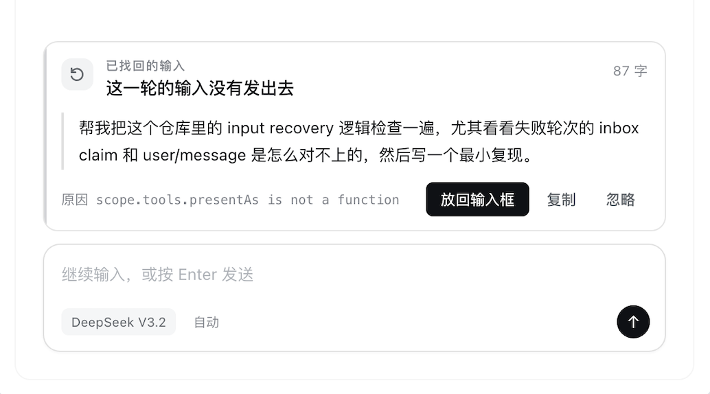

# dsh-pocket-kit

[English](README.md) · 简体中文

Pocket Kit（口袋工具箱）— 一组彼此独立的 [DeepSeek Harness](https://github.com/deepseek-ai/deepseek-harness) 小功能，每个功能都能在插件设置页单独开关（除模型选择器覆盖为需手动开启外，默认全部开启）。


## 功能

### 固定目录选择器为应用内浏览 —— `pinBrowsePicker`

让 *添加工作区* 始终使用应用内目录浏览器，而不是 macOS 系统文件选择器（系统自动选择器可能因代理或启动环境在不同启动之间切换）。修改这个开关需要重启 DSH；关闭后，下次启动会恢复系统默认。

### 找回被吞掉的输入 —— `inputRecovery`

当某一轮在失败（error / interrupted / aborted）前已经吞掉了你发出的提示时，文字会被保存，并以「放回输入框」横幅重新显示在对话里。记录存在 `$DSH_HOME/plugins/dsh-pocket-kit/recovered-input.json`（`DSH_HOME` 未设置时才回退到 `~/.dsh`）；旧地址 `$DSH_HOME/dsh-pocket-kit/` 里的数据会在启动时一次性搬过去。

[](lib/assets/lost-input.png)

### 更换左上角 Logo —— `customLogo`

把侧边栏左上角的鲸鱼图标换成插件自带的鲸鱼娘插画，图片位于 `lib/assets/whale-girl.png`。图片随包分发，且刻意不可配置——DSH 不要求 SVG，因为这个 Logo 是一个可接收任意元素的插槽，而不是文件路径。

[](lib/assets/whale-girl.png)

更多细节、HTTP 接口和「工作原理」说明见 [docs/DETAIL.md](docs/DETAIL.md)。

## 安装

已发布为 [`dsh-pocket-kit`](https://www.npmjs.com/package/dsh-pocket-kit)。把它加入 DSH profile：

```jsonc
// ~/.dsh/profiles/<profile>/package.json
{
  "dependencies": {
    "dsh-pocket-kit": "^1.0.1"
  },
  "dsh": { "profile": { "bundles": [ "dsh-pocket-kit", /* ... */ ] } }
}
```

然后在该 profile 目录运行 `npm install`，并重启 DSH。

如果要在本地 checkout 上开发，把版本号换成 `link:/path/to/dsh-pocket-kit` 即可。

每个功能开关都保存在插件自己的配置文件 `$DSH_HOME/plugins/dsh-pocket-kit/config.yaml` 里，由设置页通过 Host 读写。它既不存放在浏览器里（Web GUI 每次启动都换端口，浏览器存储会因此清空），也不存放在 profile 补丁里（那份文件人人都能改）。大多数开关改动后立即生效，但 `pinBrowsePicker` 是例外：目录选择器是启动时挂载的 Host 后端 + Client 界面组合，切换后需要重启 DSH 才会生效（设置页中对应行也会提示这一点）。

## 开发

```sh
npm test   # 十四个测试套件：host、config、client、render、banner、pin-switch、logo、logo-client、resolve、force-native-host、plugin-dir、store-path、switches、switches-client
```

新增功能：在 `lib/features/index.js` 中注册，把开关名加入 `lib/config-file.js` 的 `SWITCH_KEYS`，并把文案键加入客户端的字典。详见 [docs/DETAIL.md](docs/DETAIL.md#adding-a-feature)。

## 许可证

MIT